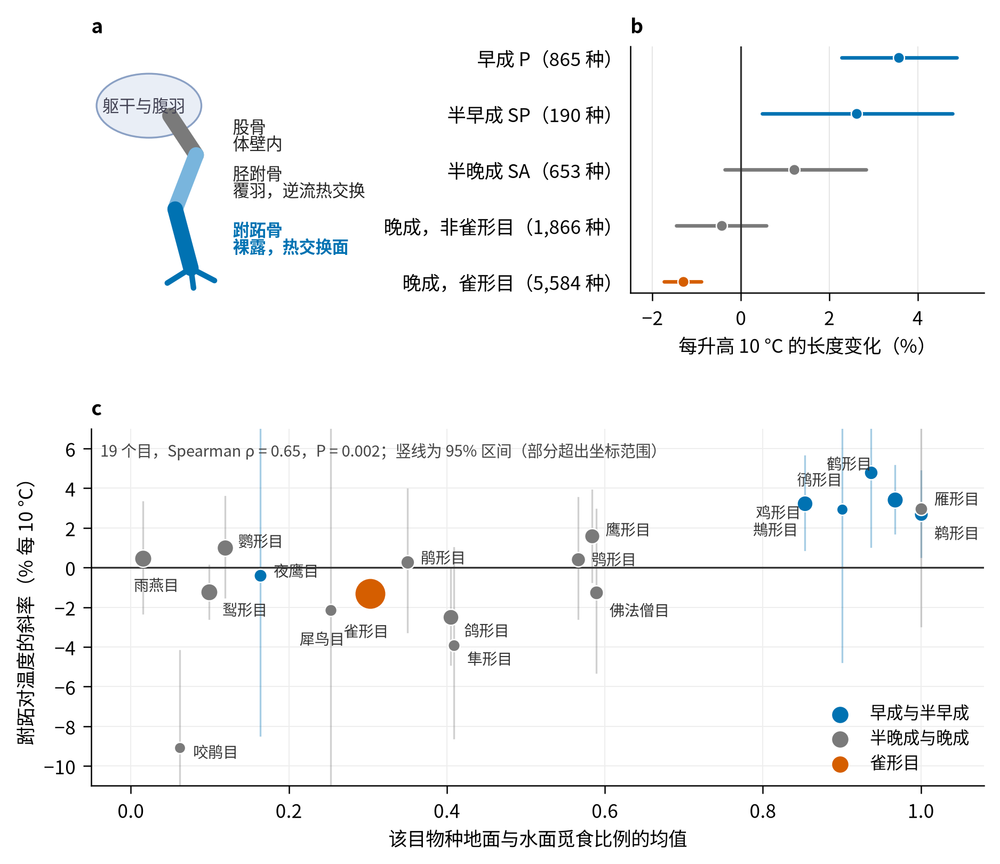
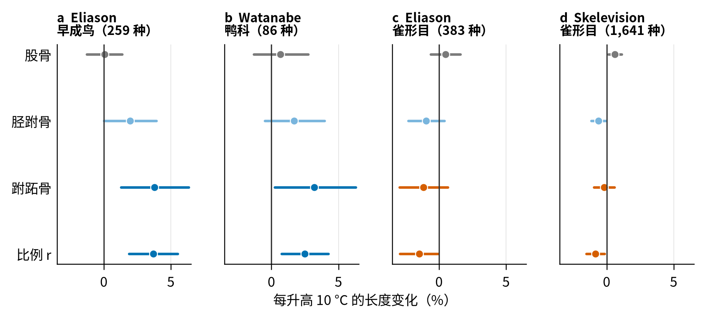
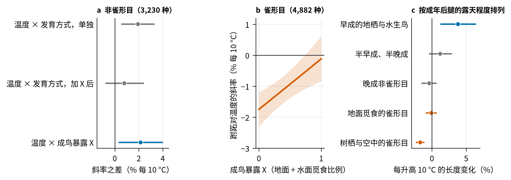
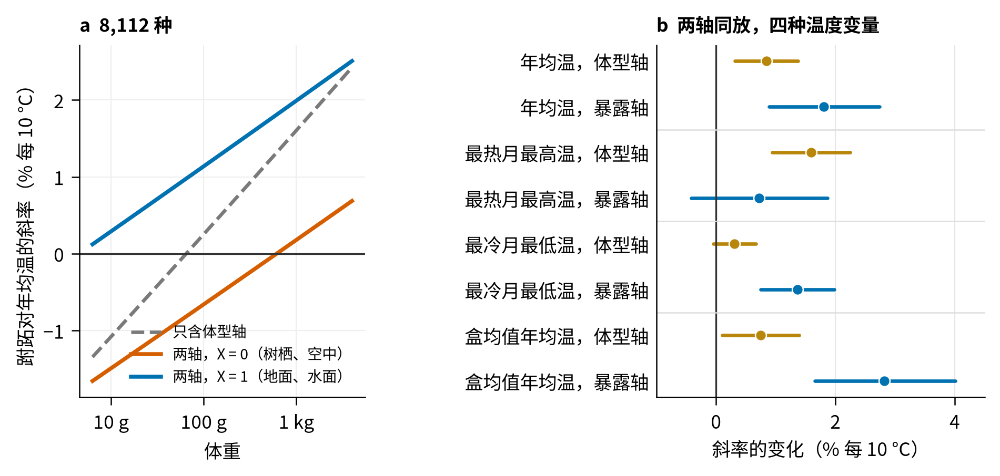
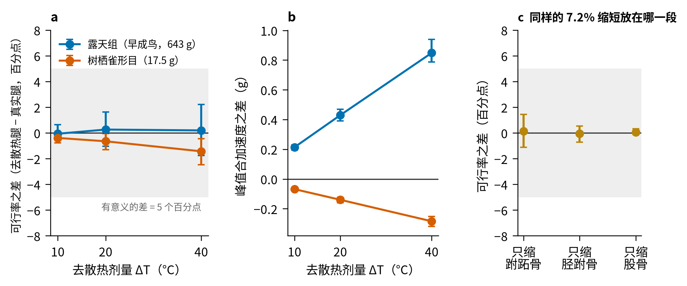
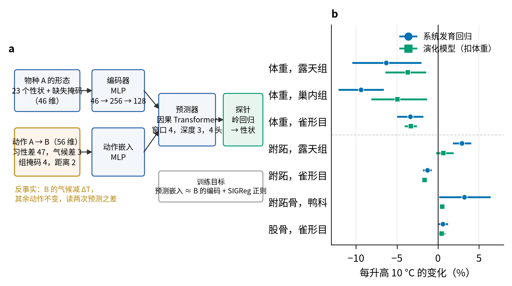

# 温暖气候下更长的跗跖骨提示体温调节在鸟腿演化中的作用

> 稿件草稿 v3（中文，2026-10-30）。在 v2 上按外部意见修改：加入体型轴与暴露轴的同场比较（新图 5），措辞从“散热塑造”退到“体温调节”，落震与演化模型的定位收紧，按目的图改为各目斜率对觅食暴露的散点。体例为 Nature Communications，段落脉络对照 Weeks 等 2025（GEB）。系数为 $\log_{10}$ 长度每升高 10 °C 的变化，0.0043 对应 1%，方括号为 95% 区间。

## 摘要

Allen 定律描述恒温动物在温暖地区附肢相对更长，通常归因于体温调节，但附肢作为整体被测量时，这一作用无法与其他塑造附肢的力量区分。鸟腿三段中只有跗跖骨裸露并与环境交换热量，体温调节的解释因此预测温度的作用落在这一段上。我们在 9,158 种鸟的外测跗跖和三份独立的三段腿骨数据上检验这一预测。温度的作用只落在跗跖骨上，股骨不响应。响应的方向由两个独立的轴决定，一是体型，二是成年后腿暴露于环境的程度，后者解释的变异多于前者，并在非雀形目内部取代了体型的作用。两个轴对应不同的温度极端，对最热月温度的响应随体型变化，对最冷月温度的响应随暴露程度变化。整天站在露天的地栖和水生鸟每升高 10 °C 跗跖骨长 1.5% 到 3.8%，把腿缩进腹羽的树栖雀形目反向。多体落震仿真表明这一量级的加长落在被动落地的不敏感区内。这些结果把鸟腿上的 Allen 定律定位在裸露段，并指出成年后腿的暴露是此前未被识别的决定因素。

## 引言

在产热与散热之间维持平衡是恒温动物的基本要求。Bergmann 定律与 Allen 定律分别描述体型和附肢比例随气候的变化，前者指寒冷地区的体型更大，后者指温暖地区的附肢相对更长，两者都被解释为对散热需求的适应。这两条规律在哺乳动物的耳与尾、鸟类的喙和腿上得到过大量支持，近年来基于全球性状数据库的研究把检验扩展到上万种鸟类，并发现跗跖对温度的响应随体型改变方向，大型鸟在温暖地区跗跖更长而小型鸟更短。然而把附肢当作整体来测量，无法区分体温调节的选择与其他塑造附肢的力量，Allen 定律背后的选择机制仍不清楚。理清这些机制是理解形态如何响应气候的必要一步。

围绕 Allen 定律，我们问体温调节是否塑造了鸟腿，以及它作用在腿的哪一段。喙和腿的整体长度同时服务于取食和运动，温度与它们的关系可以有体温调节以外的来源。鸟腿由三段组成，只有最远端的跗跖骨裸露无羽并与环境直接交换热量，股骨包在体壁内，胫跗骨大部分覆羽并有逆流热交换的血管网。把腿分成热交换段与非热交换段来检验，可以得到更机制性的理解。

鸟腿是重要的热交换部位。站立和涉水的鸟把腿暴露在空气或水中，裸露的跗跖是腿上主要的热交换面，逆流热交换只保护胫跗骨以上的部分。水的导热远大于空气，涉水鸟腿上的热损失可占总热损失的相当部分，因此地面与水面活动的鸟在温暖地区需要更大的腿部散热面，在寒冷地区则需要更小的。相反，栖枝的鸟在休息时把腿缩进腹羽，裸露段被羽毛覆盖，腿在这时几乎不与环境交换热量。腿暴露于环境的时间份额因此随生活方式差异很大，体温调节对腿的选择强度也应当随之变化。

我们在 9,158 种鸟的外测跗跖和三份独立的三段腿骨数据上刻画腿的热交换面随温度的变化，骨长分别来自人工测量的 1,096 种、鸭科的 90 种和自动测量的 1,641 种雀形目。具体而言，我们检验两个假说。第一，温度升高只与跗跖骨变长相关，股骨不变。第二，这种相关随成年后腿暴露于环境的程度增强，并且独立于前人报告的体型依赖。我们进一步用三段腿的落震仿真询问温度造成的加长是否以落地性能为代价，并用一个不含先验规律的演化模型作为回归框架之外的探索性检查。

## 结果

### 跨物种格局与分段预测

控制体重、生活方式、栖境密度、迁徙等级和纬度跨度之后，9,158 种鸟的外测跗跖对年均温的总斜率接近零（$-0.0007$，$[-0.0023, +0.0009]$）。零来自两个相反的信号。非雀形目的跗跖在温暖地区更长（$+0.0071$，$[+0.0042, +0.0100]$，3,574 种），雀形目在温暖地区更短（$-0.0057$，$[-0.0076, -0.0039]$，5,584 种）。先前报告的“大型鸟为正、小型鸟为负”与这两个信号部分重合，因为非雀形目整体较大，两种解释的关系在后文直接检验。

分段预测在骨长数据上成立。在 Eliason 等人测量的早成鸟（259 种）中，股骨对温度没有响应（$+0.0002$），胫跗骨居中（$+0.0084$），跗跖骨每升高 10 °C 长 3.8%（$+0.0161$，$[+0.0055, +0.0267]$），比例 $r$ 随温度上升（$+0.0157$，$[+0.0081, +0.0233]$）。Watanabe 的鸭科 86 种给出同样的格局，只有跗跖骨响应（$+0.0137$，$[+0.0010, +0.0265]$），股骨不动（$+0.0029$，$[-0.0058, +0.0117]$），$r$ 为正（$+0.0107$，$[+0.0033, +0.0181]$）。雀形目的 $r$ 在 Eliason 的 383 种中为负（$-0.0065$，$[-0.0129, -0.0002]$），在 Skelevision 的 1,641 种中同向（$-0.0036$，$[-0.0066, -0.0007]$）。同一批 Skelevision 数据上的肱骨和尺骨每 10 °C 长 1.5% 到 1.9%，复现了此前报告的翅骨格局，说明温度提取与回归流程没有问题（图 2）。

**图 1　鸟腿的三段与外测跗跖对温度的响应。** **a**，鸟腿三段的位置与覆盖。**b**，AVONET 外测跗跖对分布区年均温的斜率，按发育方式分为五档（非雀形目按科编码，雀形目全部为晚成），点为估计值，横线为 95% 区间，横轴为每升高 10 °C 的长度变化。**c**，各目（40 种以上）的斜率对该目物种地面与水面觅食比例的均值，点的大小表示物种数，颜色标出发育方式，竖线为 95% 区间。所有模型为系统发育广义最小二乘，协变量为体重、生活方式、栖境密度、迁徙等级和纬度跨度。

**图 2　温度的作用只落在跗跖骨上。** 三段腿骨与比例 $r = \log_{10}(\text{跗跖骨}/\text{股骨})$ 对温度的斜率。**a**，Eliason 等人测量的早成鸟。**b**，Watanabe 测量的鸭科，与 a 独立。**c**，Eliason 等人测量的雀形目。**d**，Skelevision 自动测量的雀形目。横线为 95% 区间。

### 响应强度随成年后腿的暴露程度变化

温度对跗跖骨的作用在一个由生活方式构成的选择景观上展开。我们先按发育方式把非雀形目分为腿在巢外生长的暴露组（早成与半早成，1,055 种）和腿在巢内生长的巢内组（半晚成与晚成，2,519 种）。暴露组的跗跖斜率为 $+0.0125$（$[+0.0082, +0.0168]$），巢内组为 $+0.0034$（$[-0.0003, +0.0071]$），之差 $+0.0091$（$[+0.0037, +0.0146]$）。最严格的早成对晚成之差为 $+0.0166$（$[+0.0102, +0.0231]$）。按目拆开，五个早成目的斜率全部为正且四个区间不含零，晚成与半晚成目中点估计为正的是鹭、鹮与猛禽所在的鹈形目和鹰形目，为负的是咬鹃、啄木鸟和鸽这些树栖类群。各目的斜率与该目物种地面和水面觅食比例的均值正相关（19 个目，Spearman $\rho = 0.65$，$P = 0.002$，图 1c），按目的排列与发育方式并不一致，而与成年后的活动环境一致。细分为四档后斜率呈单调梯度，从早成的 $+0.0152$ 经半早成的 $+0.0112$ 和半晚成的 $+0.0052$ 降到晚成非雀形目的 $-0.0019$，再到雀形目的 $-0.0057$（图 1）。

发育方式本身不是机制。暴露组七成是地栖和水生鸟，加入温度与生活方式的交互后两组之差降到 $+0.0052$（$[-0.0015, +0.0119]$）。两条直接针对雏鸟期热环境的检验都为零。巢内组内部开放巢与洞巢和封闭巢的斜率之差为 $+0.0036$（$[-0.0054, +0.0127]$，1,626 种），留巢天数在各发育方式内部都不改变斜率。成年后腿暴露于环境的程度解释了这条梯度。在非雀形目（3,230 种）中，单独放入发育方式时温度与发育方式的交互为 $+0.0083$（$[+0.0025, +0.0140]$），同时放入成鸟暴露 $X$ 后降到 $+0.0034$（$[-0.0033, +0.0102]$），而温度与 $X$ 的交互为 $+0.0092$（$[+0.0015, +0.0169]$）。同一变量在雀形目内部给出一条连续的梯度，完全树栖或空中觅食的雀形目（$X = 0$）斜率为 $-0.0076$（$[-0.0101, -0.0052]$），温度与 $X$ 的交互为 $+0.0071$（$[+0.0031, +0.0112]$），完全在地面觅食的雀形目斜率接近零（图 3）。把全部类群按成年后腿的露天程度排列，响应从整天站在露天的雁鸭、鸡形、鸻鹬、鹤和秧鸡的每 10 °C 1.5% 到 3.8%，经中等暴露的鸥、猛禽和鹭的 0.5% 到 1.1%，到树上与空中的鹦鹉、鸽、雨燕和啄木鸟的零，再到把腿缩进腹羽的树栖雀形目的 $-0.8\%$ 到 $-1.7\%$（表 1）。

**图 3　响应强度由成年后腿的暴露程度决定。** **a**，非雀形目中温度与发育方式的交互在单独放入时为正，与成鸟暴露 $X$ 同时放入后降到零，而温度与 $X$ 的交互为正。**b**，雀形目中跗跖对温度的斜率随 $X$ 的变化，阴影为 95% 置信带。**c**，按成年后腿的露天程度排列的类群梯度，早成的地栖与水生鸟取 Eliason 跗跖骨，其余取外测跗跖。

### 体型与成鸟暴露是两个独立的轴

Fröhlich 等人把跗跖响应方向的变化归于体型。我们在同一批 8,112 种鸟、同样的协变量和系统发育框架下比较两种解释，模型分别加入温度与体重的交互、温度与成鸟暴露的交互，以及两者同时加入。只含体型交互的模型重现了先前的格局，10 g 的鸟每 10 °C 为 $-0.0047$，1 kg 的鸟为 $+0.0069$。只含暴露交互的模型比只含体型交互的模型 AIC 低 76.3。两者同时加入后，暴露交互为 $+0.0078$（$[+0.0038, +0.0118]$），体型交互从 $+0.0058$ 降到 $+0.0037$（$[+0.0014, +0.0059]$），保留 63%（图 4a）。两个轴各自独立而暴露轴更强，同一体重下从完全树栖到完全露天带来的斜率变化与从 10 g 到 1 kg 的体型效应相当。在非雀形目（3,230 种）内部，体型交互本身不显著（$+0.0027$，$[-0.0007, +0.0061]$），加入暴露后降到 $-0.0011$，暴露交互为 $+0.0124$（$[+0.0041, +0.0206]$）。全鸟类水平上的体型轴有相当一部分来自雀形目体型小且响应反向这一事实。依次去掉每个 40 种以上的目，暴露交互的区间都不含零，取值在 $+0.0053$ 到 $+0.0124$ 之间。

两个轴对应不同的温度极端（图 4b）。把年均温换成最热月最高温，体型交互为 $+0.0068$（$[+0.0041, +0.0096]$），暴露交互降到不显著（$+0.0031$，$[-0.0018, +0.0080]$）。换成最冷月最低温，暴露交互为 $+0.0059$（$[+0.0032, +0.0085]$），体型交互不显著（$+0.0013$，$[-0.0002, +0.0029]$）。对热端的响应随体型变化，对冷端的响应随成年后腿的暴露程度变化。这一分工在设计中没有预先设定，我们把它作为探索性结果报告。

**图 4　体型与成鸟暴露是两个独立的轴。** **a**，跗跖对年均温的斜率随体重的变化。灰色虚线为只含体型交互的模型，彩色实线为同时含体型与暴露交互的模型在 $X = 0$（完全树栖或空中觅食）与 $X = 1$（完全地面或水面觅食）时的取值，8,112 种。**b**，同时含两个交互的模型在四种温度变量下的体型交互（体重每增加十倍，斜率的变化）与暴露交互（$X$ 从 0 到 1，斜率的变化），横线为 95% 区间。

### 稳健性与种内检验

我们同时控制了迁徙策略。发育方式组间的差别在留鸟、部分迁徙和完全迁徙的物种中方向一致，换用最热月最高温或最冷月最低温后不变，用分布范围内的盒均值温度替代质心温度后不变，去掉归类不确定的科后不变。按体重分档，暴露组与巢内组的差别在小于 100 g、100 到 1,000 g 和大于 1,000 g 三档中都存在。物种级的保温行为记录（坐下盖腿与单腿站立，704 种）与温度斜率没有可检出的关系，这份数据对腿的暴露程度没有分辨力（补充信息）。种内层面，密歇根大学动物博物馆的 79 种雀形目 998 件标本给出的交互项为 $+0.0006$（$[-0.0278, +0.0289]$），区间宽度是跨物种效应的两倍，现有标本数不足以检出种内效应。

### 温度造成的加长落在被动落地的不敏感区内

跗跖骨既是热交换面也是落地时的承力段，我们用三段腿的多体落震模型询问温度造成的加长是否改变落地性能。对于露天组，真实腿取早成鸟 259 种的中位数（跗跖骨 50.1 mm，胫跗骨 80.9 mm，股骨 50.6 mm，体重 643 g），去散热腿的跗跖骨短 7.2%，胫跗骨短 3.8%，股骨不变。去散热腿的落地可行率为 32.0%，真实腿为 31.8%，之差 $+0.3$ 个百分点（$[-1.0, +1.6]$），把温度回推到 40 °C 时之差仍为 $+0.2$ 个百分点（$[-1.8, +2.2]$），三种敏感性判据下同样如此（图 5）。次要读数有方向而量很小，温度造成的加长使峰值加速度降低 0.43 g、腿行程增加 1.2% 腿长，落地略软但不改变可行与否。树栖雀形目的腿按相反方向回推后变长 2.4%，可行率从 29.7% 变为 29.0%（之差 $-0.7$ 个百分点，$[-1.3, -0.1]$）。把同样 7.2% 的缩短量单独放在胫跗骨或股骨上，可行率的变化都在 0.1 个百分点以内，被动落震对这一量级的任何一段长度变化都不敏感。落震结果因此说明温度在这一范围内塑造跗跖骨不受被动落地的约束，但不解释温度为何只作用于跗跖骨。

**图 5　温度造成的跗跖骨加长不改变落地可行率。** **a**，去散热腿与真实腿的落地可行率之差随去散热剂量的变化，灰带为 5 个百分点的有意义阈值，误差线为按参数组自助重抽样的 95% 区间。**b**，峰值合加速度的配对差。**c**，把同样 7.2% 的缩短量分别放在三段之一上，露天组。

### 不含规律的演化模型重现响应方向（探索）

最后，作为探索性检查，我们训练了一个只从数据学习的演化模型。模型沿系统发育树预测相邻物种的性状，输入不包含任何关于温度或体型的规律。在留出科的物种上把气候降低 20 °C，模型推出体重随温度变小，每 10 °C 为 $-0.0163$（露天组）、$-0.0220$（巢内组）和 $-0.0146$（雀形目），与同样数据上的系统发育回归（$-0.0284$，$[-0.0474, -0.0095]$；$-0.0429$，$[-0.0556, -0.0302]$；$-0.0150$，$[-0.0217, -0.0084]$）方向一致，两组落在区间内。扣除体重后，模型给出的跗跖响应在露天组为正（$+0.0029$，$[-0.0005, +0.0077]$），在雀形目为负（$-0.0072$，$[-0.0081, -0.0062]$）且落在回归区间内，雀形目内部的响应随成鸟暴露增加（$+0.0023$，$[+0.0006, +0.0037]$）。模型低估了露天组的效应量。预先设定的校准使用未扣除体重的读数，没有通过，扣除体重是看到结果之后的修订，我们因此只把这部分作为方向上的旁证。

**图 6　一个不含先验规律的演化模型重现响应的方向。** **a**，模型结构。前一物种的 23 个形态性状经编码器进入嵌入空间，两物种之间的习性与气候差值和进化距离作为动作，因果 Transformer 预测器给出下一物种的嵌入，岭回归探针读出性状。反事实把目标物种的气候减 $\Delta T$，其余动作不变。**b**，模型在留出科上给出的每 10 °C 变化与同样数据上的系统发育回归对照，腿的读数已扣除体重的变化。

## 讨论

鸟腿的形态通常被认为由运动塑造，栖枝、行走、奔跑、涉水与起跳对三段的长度和比例各有要求，温度在这些讨论里很少出现。我们的结果表明温度也塑造鸟腿，但只作用在裸露的跗跖骨上，股骨不变。这一分段在早成鸟与鸭科两份独立的骨骼数据上一致，与跗跖是腿上主要的热交换面而股骨包在体壁内的生理事实相符。温度对腿的作用因此不是整条附肢按比例的缩放，而是对裸露段的局部塑形。

我们把温度与跗跖骨长度的关系解释为体温调节的选择，并识别出两条独立的路径。第一条是体型。大型鸟的表面积相对体积较小，在炎热条件下散热更难，更长的裸露跗跖骨增加散热面积，对最热月温度的响应因此随体型增强，这与 Fröhlich 等人的解释一致。第二条是成年后腿的暴露。腿长时间露在空气或水中的鸟在寒冷条件下经跗跖持续损失热量，更短的跗跖骨减少这一损失，而把腿缩进腹羽的鸟不承担这一代价，对最冷月温度的响应因此随暴露程度增强。暴露轴在全鸟类水平上比体型轴解释更多的变异，并在非雀形目内部取代了体型轴。发育方式表面上的作用来自它与成年后暴露的重合，雏鸟期的巢型与留巢时长不改变斜率。热端与冷端的分工来自探索性分析，需要用独立的数据检验，但它提示先前报告的体型依赖只是两条路径中的一条。

两条路径对气候变暖下的形态响应给出不同的预测。如果冷端的热损失是暴露类群跗跖偏短的主要原因，变暖放松的是对长跗跖的约束，雁鸭、鸻鹬、鸡形与鹤的跗跖可以随升温变长，而树栖的鹦鹉、鸽和多数雀形目没有这条通道。已报告的雀形目跗跖在四十年间缩短 2.4%，远大于本文的斜率在同期升温下所能解释的量，更可能来自体型的变化。预测哪些类群会以哪种附肢响应升温，需要把体型、暴露与每个支系的热交换部位放在同一个框架里。

鸟腿的几何同时受落地力学约束。我们的仿真表明温度造成的变化落在被动落震的不敏感区内，体温调节在这一范围内塑造跗跖骨不受落地约束。同样的长度变化放在任何一段上也不敏感，所以力学不解释温度为何只作用于跗跖骨，作用的位置由热交换面的位置决定。翅上的情况不同，Weeks 等人发现翅骨的加长与飞行敏捷性指标负相关。我们的模型只包含被动的关节弹簧与阻尼，没有主动肌肉，结论限于被动落地。

我们的结果对一系列控制稳健，模型中体重、生活方式、栖境密度、迁徙等级和纬度跨度都已纳入，换用不同的温度变量、分布范围内的均温、不同的系统发育树和不同的发育方式编码都不改变分段与暴露轴的格局。成鸟暴露是由觅食层推出的代理，不是腿实际露在环境里的时间，它同时混合了运动方式、空气与水环境和休息姿态，物种级的保温行为记录也没有提供更直接的分辨。树栖雀形目的反向尚未得到完整解释。加入觅食层与栖境密度后反向只略有减弱，可能的解释包括热带森林更密的树冠使温度成为树栖形态的代理、热带小型鸟的裸露皮肤在失水上的代价，以及雀形目把热交换窗口让渡给翅与喙之后腿进一步缩进羽毛。种内层面的检验没有闭合，现有标本的区间宽度是跨物种效应的两倍。演化模型在方向上与回归一致，但预先设定的校准没有通过，它不承担独立验证的角色。

先前的研究表明体温调节可以影响取食器官和飞行器官的形态，本文把这一结论扩展到腿，把作用位置定位在裸露段，并指出决定方向的除了体型还有成年后腿的暴露。比较数据本身不能确立机制。直接区分散热与保温需要腿部热通量的测量，带温度梯度的大样本标本则可以检验种内的可塑性是否沿同一方向。

## 方法

### 数据

外测跗跖、体重、生活方式、栖境密度、迁徙等级和分布范围来自 AVONET，取有实测值的 9,158 种。温度取 WorldClim 2.1 的年均温、最热月最高温和最冷月最低温，分辨率 2.5 角分，在 AVONET 分布质心处采样，质心落在海里时取 1° 内最近的陆地像元，稳健性分析另用分布范围内的盒均值温度。系统发育用 BirdTree 的 Hackett 主干树，主分析用第 21 棵，稳健性用第 41、61、81、100 棵和 Ericson 主干。

三段腿骨来自三个来源。Eliason 等人人工测量的股骨、胫跗骨、跗跖骨和肱骨覆盖 1,246 种，经 AVONET 的分类对照表对上树的有 1,096 种，其中非雀形目 713 种。Watanabe 的鸭科三段腿骨覆盖 90 种，与 Eliason 的数据独立。Skelevision 用神经网络从密歇根大学动物博物馆的骨骼照片测量的 12 根骨长覆盖 1,641 种雀形目，平均误差 0.89 mm，同一数据集给出肱骨和尺骨作为对照。发育方式按 Starck 与 Ricklefs 的分类在科一级编码为早成、半早成、半晚成和晚成四档，共 97 科，五个归类不确定的科在稳健性分析中去掉。巢型与留巢天数来自 Cooney 等人的汇编。觅食层比例来自 EltonTraits，成鸟暴露 $X$ 定义为地面、水面附近和水下觅食比例之和，取值 0 到 1，作为成年后腿露在环境里的时间份额的代理。

### 跨物种模型

对每个响应变量 $y_j$（某段骨长或外测跗跖的 $\log_{10}$ 值）拟合系统发育广义最小二乘模型，表达为

$$y_j = a + b\,M_j + c\,T_j + \boldsymbol\gamma^{\top}\mathbf x_j + \epsilon_j, \tag{1}$$

其中 $M_j$ 是 $\log_{10}$ 体重，$T_j$ 是分布质心的年均温（单位 10 °C），$\mathbf x_j$ 包括生活方式、栖境密度、迁徙等级和纬度跨度，残差 $\epsilon_j$ 的协方差由系统发育树给出并以 Pagel 的 $\lambda$ 缩放。分段预测的核心量是跗跖骨对股骨的比例 $r = \log_{10}(\text{跗跖骨}/\text{股骨})$ 对温度的斜率，以及三段各自的斜率之差。分组分析在式 (1) 中加入温度与分组的交互 $c_g\,T_j\,g_j$，$c_g$ 即两组斜率之差，成鸟暴露分析把 $g_j$ 换为连续的 $X_j$。系数的区间来自固定 $\lambda$ 的广义最小二乘协方差，主模型另按科重抽样 500 次。每一步的假说、纳入规则与判据在运行前写定，最小关心效应为每 10 °C 1%，运行后的拆分标为探索。

### 体型与暴露的同场比较

在同时具有实测跗跖、温度、体重、成鸟暴露与全部协变量的 8,112 种鸟上拟合四个模型。基线为式 (1)，其余三个分别加入温度与体重的交互 $T_j M_j$，加入 $X_j$ 与 $T_j X_j$，以及两者同时加入。体重在样本均值处中心化，各模型的 $\lambda$ 分别估计，用 AIC 比较。逐目留一依次去掉 40 种以上的每个目，重拟同时加入两者的模型。判据在运行前写定，换温度变量的分析列为稳健性。

### 种内模型

密歇根大学动物博物馆标本的采集坐标、性别和年份来自 GBIF 的 Darwin Core 记录，温度在采集点采样。纳入成体、性别已知、采集点在物种分布范围内且无圈养记录的标本，留鸟取全年，迁徙种只取繁殖季。混合模型表达为

$$y_{ij} = \alpha_j + \beta_j\,\tilde T_{ij} + \gamma\,\tilde T_{ij}X_j + \delta\,\mathrm{sex}_{ij} + \theta\,\mathrm{year}_{ij} + e_{ij}, \tag{2}$$

其中 $i$ 为标本，$j$ 为物种，$\tilde T_{ij}$ 为在物种内中心化的温度，$\alpha_j$ 与 $\beta_j$ 为物种的随机截距与随机斜率，$\gamma$ 是成鸟暴露每增加 1 时种内斜率的增量。主样本为 79 种 998 件。

### 落震仿真

落震模型在 Exudyn 中实现，三段刚性杆由髋、膝、踝三个扭簧阻尼关节连接，足端与地面为罚接触，机身在竖直面内自由平动。真实腿取类群三段骨长与体重的中位数，去散热腿把每一段按它自己的温度斜率从 25 °C 推回 5 °C，体重不变。两条腿共用同一批 256 组关节参数、三种地面和两档触地速度，逐组配对，可行率为四道落震判据同时满足的参数组比例，有意义的差定为 5 个百分点。工况、参数盒与判据的数值见补充方法。

### 演化模型

演化模型采用联合嵌入预测架构的单层形式，沿系统发育树的叶序把相邻物种组织为序列。输入为前一物种的 23 个形态性状，动作为两物种之间习性与气候的差值和进化距离，模型在嵌入空间预测下一物种的表示，性状由岭回归探针读出。训练用五棵 Hackett 树、两个随机种子和按科五折交叉验证共 50 个模型，评估只在留出科的物种上进行。反事实读数把目标物种的三项气候各减 20 °C，取观测动作与反事实动作预测之差，扣除体重的影响时减去该列对体重的异速斜率乘以体重的变化。

### 预注册与代码

每一步分析先写定假说、模型、纳入规则与判据再运行，运行后的拆分标为探索。设计与结果文档、分析脚本、落震模型和演化模型的代码随文公开。

## 补充材料清单

- 补充方法　落震仿真的工况、参数盒与四道判据的数值（下文），演化模型的训练设置。
- 补充图 1　五档发育方式在 Eliason 骨长上的梯度。
- 补充图 2　巢型与留巢天数的检验。
- 补充图 3　换用最热月、最冷月与盒均值温度后，发育方式组间差别与分段的稳健性。
- 补充图 4　落震的各工况可行率、敏感性判据与次要读数。
- 补充图 5　演化模型未扣体重的原始读数与三个 $\Delta T$ 的线性。
- 补充表 1　按目的斜率、样本量与地面和水面觅食比例的均值。
- 补充表 2　体型与暴露同场比较的四个模型在三个样本与四种温度下的全部系数，以及逐目留一。
- 补充表 3　保温行为记录（Pavlovic 等 2019）与温度斜率。
- 补充表 4　种内混合模型的全部读数。

### 补充方法　落震仿真

落震模型在 Exudyn 中实现。三段刚性杆由髋、膝、踝三个转动副连接，每个关节附扭簧与阻尼，足端为球体与地面的罚接触，机身为点质量并在竖直面内自由平动。真实腿取类群三段骨长与体重的中位数，去散热腿把每一段按它自己的温度斜率从 25 °C 推回 5 °C，体重不变。载荷取体重的一半，足端半径、杆件线密度与机身等效半径由真实腿定一次并对所有腿相同。关节刚度、阻尼和触地姿态在预注册的参数盒内用拉丁超立方取 256 组，所有腿共用。地面取硬地、草地和湿沙三档，触地速度按 Froude 数从参考档换算到真实腿的长度并对所有腿固定。可行率为峰值合加速度不超过 10 g、腿行程不超过腿长的 15%、回弹不超过触地动能对应高度的 5%、足端滑移不超过跗跖骨长一半四道判据同时满足的参数组比例，之差的区间按参数组自助重抽样 10,000 次，有意义的差定为 5 个百分点。
